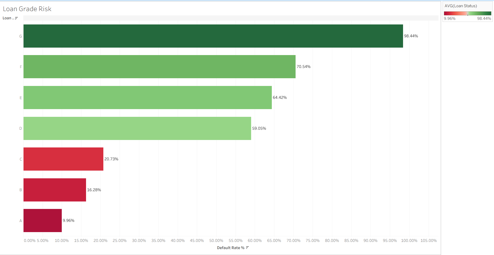
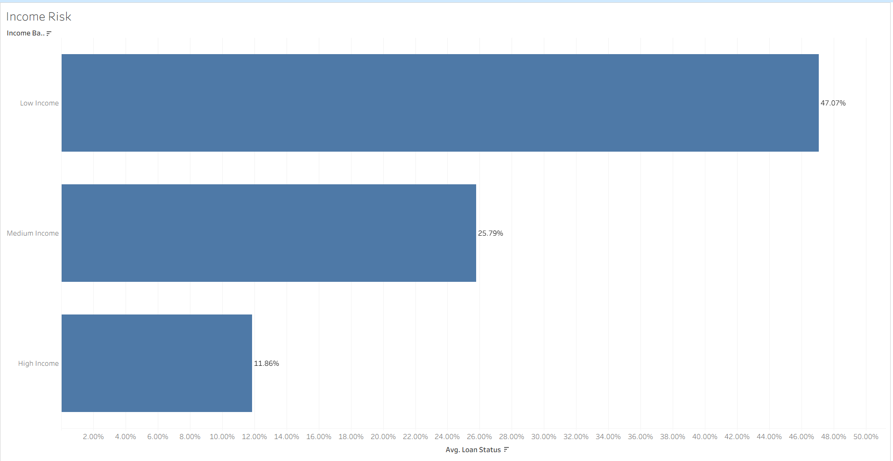
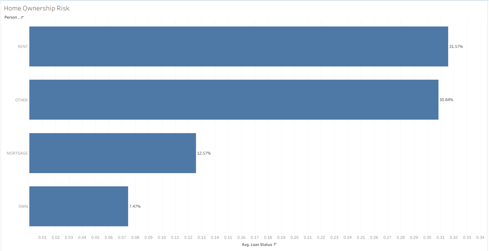
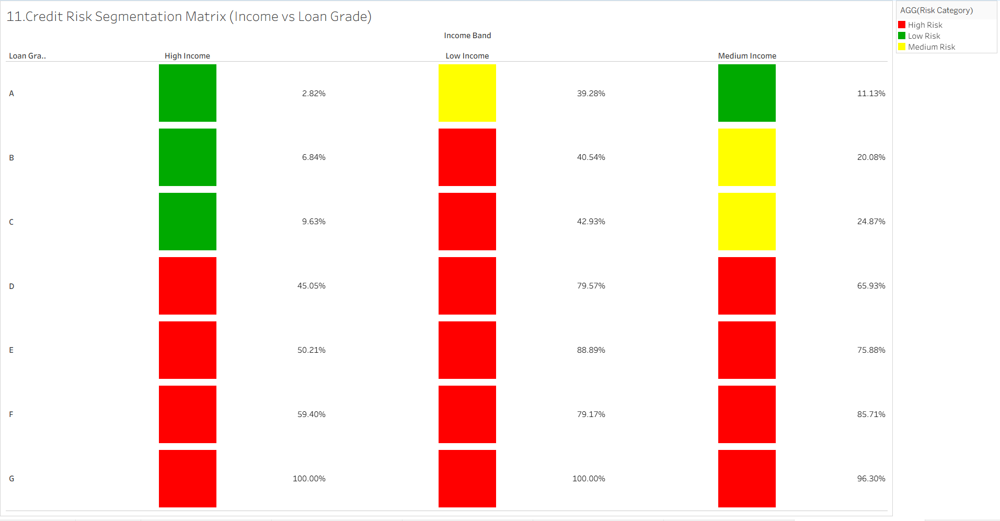
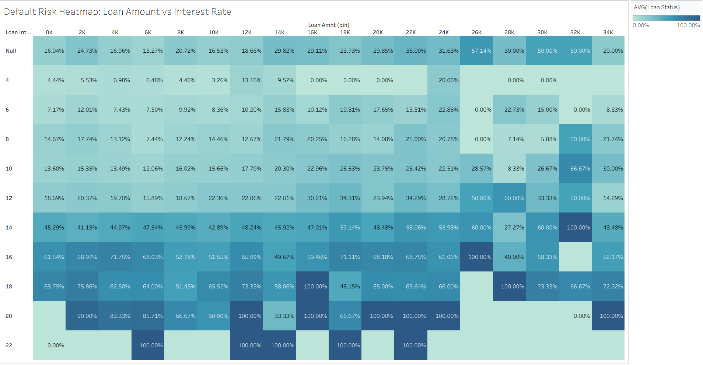
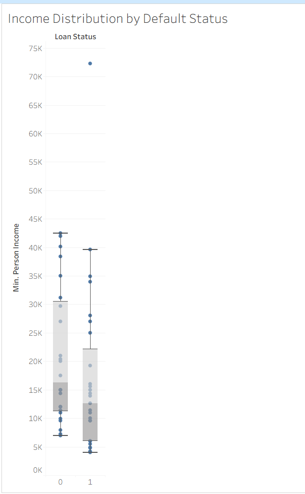

# Credit-risk-analysis
Exploratory credit risk analysis of 32,000 peer-to-peer loans using Excel and Tableau, with visual insights into factors associated with loan defaults.

# Credit Risk Analysis for FinTech Lending

## Project overview

This project explores how borrower and loan characteristics relate to loan defaults in a peer-to-peer lending dataset of approximately 32,000 records. I used Microsoft Excel to prepare and analyse the data, then Tableau to create visualizations that make patterns in credit risk easier to explore.

The goal was to turn loan data into clear, interpretable insights that could support an initial review of lending risk. The analysis focuses on factors such as income, loan grade, interest rate, loan amount, home ownership, loan purpose, and default status.

## The business problem

FinTech lenders need to assess the risk of a loan before approving it. Looking at one borrower characteristic in isolation can miss important context: a large loan, for example, may carry a different level of risk depending on the borrower’s income and the interest rate.

This project examines how several borrower and loan attributes relate to default outcomes. It presents those relationships in a visual format that business analysts and other non-technical readers can understand.

## What I did

- Prepared and explored a public credit risk dataset.
- Analysed default patterns across borrower and loan characteristics.
- Grouped selected numeric fields into categories, such as income and loan amount bands, to make comparisons easier to interpret.
- Created Tableau visualizations, including heatmaps, a box plot, a treemap, and a risk segmentation matrix.
- Summarised the findings as a proposed low-, medium-, and high-risk segmentation framework for further review.

## Key observations

The analysis suggests that default risk is associated with a combination of factors rather than a single borrower attribute. In the dataset:

- Default rates varied across loan grades and income groups.
- Home ownership categories showed different default patterns.
- Higher loan amounts and interest rates appeared together with higher default rates in some groups.
- Comparing income and loan grade together revealed patterns that were less visible when looking at either factor alone.

These are exploratory observations from this dataset. They show associations and should not be treated as proof that any one factor causes a loan to default.

## Visualizations

The images below are static exports of selected Tableau visualizations.

### Default patterns by loan grade

### Default patterns by income group

### Default patterns by home ownership

### Income and loan grade risk segmentation

### Loan amount and interest rate

### Income distribution by default status

## Tools and methods

- **Microsoft Excel:** data preparation, grouping, and exploratory analysis
- **Tableau:** data visualization and visual analysis
- **Methods:** descriptive, comparative, exploratory, and segmentation analysis

## Dataset

The project uses a public credit risk dataset from Kaggle. The fields discussed in the analysis include borrower income, employment length, home ownership, loan amount, interest rate, loan grade, loan purpose, and default status.

Dataset source: [Credit Risk Dataset on Kaggle](https://www.kaggle.com/datasets/laotse/credit-risk-dataset)

## Scope and limitations

This project presents exploratory analysis and visual findings. It does not include a validated machine learning model, a test of predictive accuracy, or an interactive Tableau workbook. The visualizations show patterns in the dataset; they should not be used on their own to approve or reject real loan applicants.

The proposed risk segments are a starting point for further analysis. Before using a segmentation approach in a real lending process, it would need additional testing, validation, and review for fairness and suitability.

## Suggested next steps

With more time and access to the underlying workbook and data, this project could be extended by validating the findings on separate data, measuring how well a risk framework identifies defaults, and checking how the approach performs across different borrower groups.
